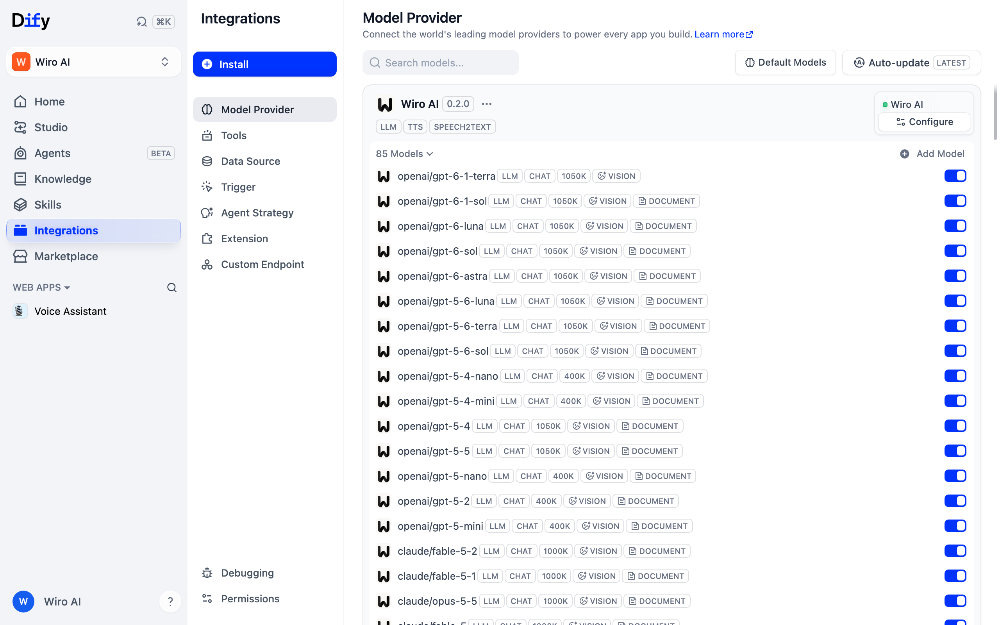
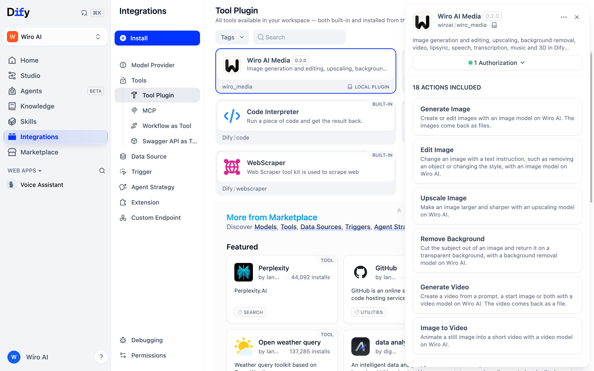
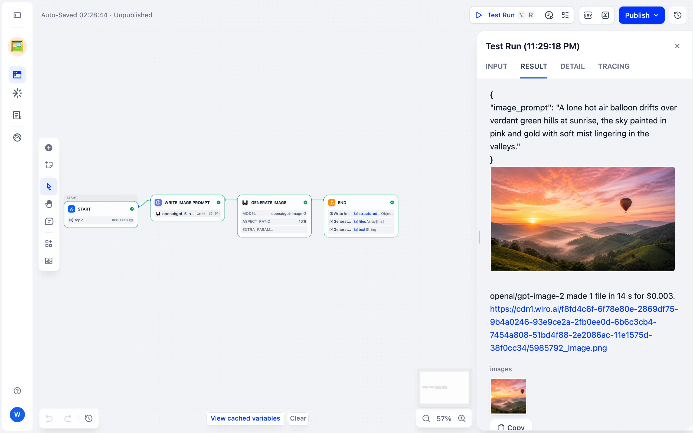
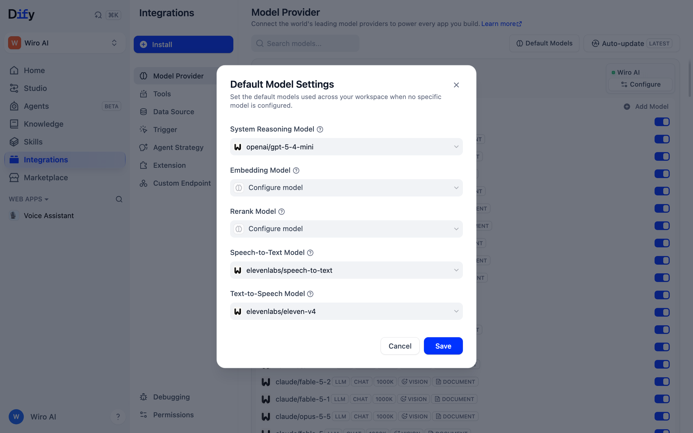
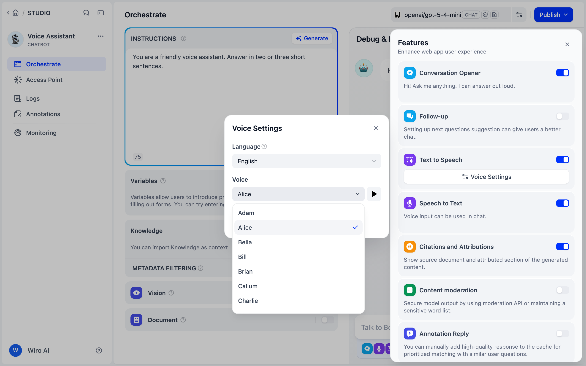

<div align="center">


# Wiro AI plugins for Dify

Use the Wiro AI LLM gateway and Wiro AI voice models as a model provider in Dify, and create images, videos, speech, music and 3D models in Dify workflows and agents with 1,000+ models on Wiro AI. Your saved Wiro AI workflows, Studio and agents run from Dify too.

[](https://marketplace.dify.ai/) [](#development) [](./LICENSE)

[Website](https://wiro.ai) · [Models](https://wiro.ai/models) · [LLM gateway](https://wiro.ai/llm) · [Docs](https://wiro.ai/docs) · [Dashboard](https://wiro.ai/panel)

</div>

[Dify](https://dify.ai) keeps model providers and tools in separate plugins, so this repository holds two of them. Both use the same Wiro AI project API key.

| Plugin | Type | What it adds to Dify |
| --- | --- | --- |
| [Wiro AI](./models/wiro) (`wiroai/wiro`) | Model provider | Chat models from OpenAI, Anthropic, Google, xAI, DeepSeek, Qwen and more through the Wiro AI gateway at `https://llm.wiro.ai/v1`, with context sizes, output limits, prices, vision, PDF input, tool calling and JSON Schema output filled in for each model. Text to speech and speech to text models from ElevenLabs, Google, OpenAI Whisper and others for Dify's voice features |
| [Wiro AI Media](./tools/wiro_media) (`wiroai/wiro_media`) | Tools | Generate Image, Edit Image, Upscale Image, Remove Background, Generate Video, Image to Video, Lipsync, Text to Speech, Speech to Text, Generate Music, Generate 3D, Run Any Model, Run Workflow, Ask Studio, Message Agent, Get Task Result, Search Models and Get Model Parameters, with results returned as Dify files |

## Install

Install both plugins from the [Dify Marketplace](https://marketplace.dify.ai/) by searching for **Wiro AI**. To install a build from this repository instead, download the `.difypkg` files from [Releases](https://github.com/wiroai/Wiro-Dify-Plugin/releases) and upload them in **Plugins > Install Plugin > Local Package File**.

## Configure the API key

1. Create a project at [wiro.ai/panel/project/new](https://wiro.ai/panel/project/new) and copy its API key. Projects that use signature authentication also have an API secret.
2. For the model provider, open the **Model Provider** page, find **Wiro AI**, click **Setup** and paste the key, plus the secret for a signature project.
3. For the tools, open the **Wiro AI Media** plugin, authorize it and paste the same key.

Both plugins check the key with a free request before saving it.





## Examples

**Chat with any gateway model.** Pick `wiro` models such as `openai/gpt-5-4-mini`, `claude/sonnet-5` or `google/gemini-3-5-flash` in a chatbot, an agent or an LLM node. Structured output, tool calling, images and PDF files work on the models that support them.

**Generate an image in a workflow.** Add the Generate Image tool, choose a model such as `google/nano-banana-2` or `openai/gpt-image-2`, and connect its `files` output to the End node.



**Turn a summary into speech.** Add Text to Speech after an LLM node and pass the LLM's text to it. The audio file comes back as a Dify file.

**Give a chatbot a voice.** On the **Model Provider** page, open **Default Models** and choose Wiro AI models as the Text-to-Speech and Speech-to-Text models. Then turn on Text to Speech and Speech to Text in a chat app's features, and the app reads its answers aloud and takes voice input.





**Prepare product photos.** Chain Edit Image, Upscale Image and Remove Background in a workflow to change a photo with an instruction, make it larger and cut out the product.

**Run your own Wiro AI workflows.** Build a workflow on Wiro AI, then run it from Dify with Run Workflow: pick it from the list and pass its inputs as JSON.

**Let an agent use any model.** Give an agent Search Models, Get Model Parameters and Run Any Model, and it can pick and run a model from the whole catalog.

The plugin READMEs cover every setting: [Wiro AI](./models/wiro/README.md) and [Wiro AI Media](./tools/wiro_media/README.md).

## Development

Each plugin is a Python 3.12 project that the [Dify plugin CLI](https://docs.dify.ai/en/develop-plugin/getting-started/cli) packages.

```bash
python3.12 -m venv .venv && . .venv/bin/activate
pip install -r models/wiro/requirements.txt pytest pyyaml

# Offline tests
(cd models/wiro && pytest tests/test_schema.py tests/test_speech.py)
(cd tools/wiro_media && pytest tests/test_offline.py tests/test_offline_v2.py)

# Live tests against Wiro AI, under $1 in total.
# In tools/wiro_media, -m "not paid" skips the tests that run models.
export WIRO_API_KEY=...
(cd models/wiro && pytest)
(cd tools/wiro_media && pytest)

# Package both plugins into dist/
scripts/package.sh
```

The model provider's model lists come from the gateway catalog and, for the voice models, from the Wiro AI model catalog. After models are added, refresh them with `python scripts/generate_models.py` (it needs `WIRO_API_KEY`) and bump the plugin version.

## More from Wiro AI

| Repository | What it is |
| --- | --- |
| [Wiro-MCP](https://github.com/wiroai/Wiro-MCP) | Official MCP server for Wiro AI, [`@wiro-ai/wiro-mcp` on npm](https://www.npmjs.com/package/@wiro-ai/wiro-mcp) |
| [Wiro-Plugin](https://github.com/wiroai/Wiro-Plugin) | Wiro AI plugin for Cursor, Claude Code, Gemini CLI, Devin, Antigravity and Kiro |
| [Wiro-Skills](https://github.com/wiroai/Wiro-Skills) | Agent skills for images, image edits, video, music, speech, transcripts, 3D and model search |
| [Wiro-LLM](https://github.com/wiroai/Wiro-LLM) | Vercel AI SDK provider for chat, images, speech, transcription and video, [`@wiro-ai/wiro-llm` on npm](https://www.npmjs.com/package/@wiro-ai/wiro-llm) |
| [Wiro-Chromium-Extension](https://github.com/wiroai/Wiro-Chromium-Extension) | Wiro AI extension for Chrome, Edge, Opera and Brave |
| [Wiro-Firefox-Extension](https://github.com/wiroai/Wiro-Firefox-Extension) | Wiro AI add-on for Firefox |
| [Wiro-Safari-Extension](https://github.com/wiroai/Wiro-Safari-Extension) | Wiro AI extension for Safari on the Mac |
| [Swift-QuickStart](https://github.com/wiroai/Swift-QuickStart) | WiroKit, the Wiro AI SDK for iOS |
| [Kotlin-QuickStart](https://github.com/wiroai/Kotlin-QuickStart) | WiroKit, the Wiro AI SDK for Android |
| [Dart-QuickStart](https://github.com/wiroai/Dart-QuickStart) | Wiro AI SDK for Dart and Flutter, [`wiro` on pub.dev](https://pub.dev/packages/wiro) |
| [ReactNative-QuickStart](https://github.com/wiroai/ReactNative-QuickStart) | Wiro AI SDK for React Native and Expo, [`@wiro-ai/wiro-react-native` on npm](https://www.npmjs.com/package/@wiro-ai/wiro-react-native) |
| [Swift-Realtime](https://github.com/wiroai/Swift-Realtime) | Realtime voice AI example for iOS |
| [Kotlin-Realtime](https://github.com/wiroai/Kotlin-Realtime) | Realtime voice AI example for Android |
| [Dart-Realtime](https://github.com/wiroai/Dart-Realtime) | Realtime voice AI example for Flutter |
| [ReactNative-Realtime](https://github.com/wiroai/ReactNative-Realtime) | Realtime voice AI example for React Native |
| [n8n-nodes-wiroai](https://github.com/wiroai/n8n-nodes-wiroai) | Wiro AI nodes for n8n, [`@wiro-ai/n8n-nodes-wiroai` on npm](https://www.npmjs.com/package/@wiro-ai/n8n-nodes-wiroai) |
| [Wiro-ComfyUI](https://github.com/wiroai/Wiro-ComfyUI) | Wiro AI nodes for ComfyUI |
| [Wiro-Hermes](https://github.com/wiroai/Wiro-Hermes) | Wiro AI plugins for Hermes Agent: image, video, audio and 3D tools, plus the LLM gateway as a model provider |
| [Wiro-Zed](https://github.com/wiroai/Wiro-Zed) | Wiro AI MCP server extension for Zed |
| [Wiro-Action](https://github.com/wiroai/Wiro-Action) | GitHub Action for Wiro AI models and the LLM gateway, [on the GitHub Marketplace](https://github.com/marketplace/actions/wiro-ai-action) |
| [Wiro-Raycast](https://github.com/wiroai/Wiro-Raycast) | Wiro AI extension for Raycast: image and video generation, LLM chat and model search |
| [Wiro-WordPress](https://github.com/wiroai/Wiro-WordPress) | Wiro AI plugin for WordPress: featured images, image edits, alt text, narration and SEO suggestions |
| [Wiro-Obsidian](https://github.com/wiroai/Wiro-Obsidian) | Wiro AI plugin for Obsidian: images, video, speech, music, transcription and text tools |
| [Wiro-Blender](https://github.com/wiroai/Wiro-Blender) | Wiro AI add-on for Blender: text to 3D, image to 3D and textures |
| [Wiro-Figma](https://github.com/wiroai/Wiro-Figma) | Wiro AI plugin for Figma: images, vectors, image edits and text |
| [Wiro-Next-Starter](https://github.com/wiroai/Wiro-Next-Starter) | Next.js starter for Wiro AI: Playground, image, video and audio tools, and LLM chat, ready for Vercel and Railway |
| [Wiro-Docs](https://github.com/wiroai/Wiro-Docs) | Source of the Wiro AI API docs |

[Website](https://wiro.ai) · [Models](https://wiro.ai/models) · [Docs](https://wiro.ai/docs) · [X](https://x.com/wiroai)

## License

MIT, see [LICENSE](./LICENSE).
